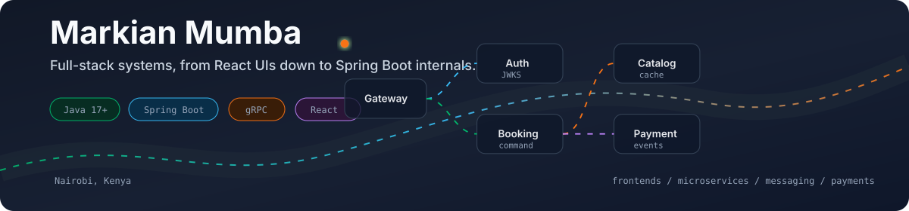
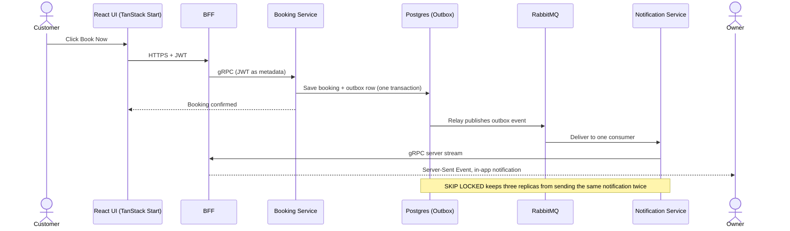

  

<h1 align="center">Markian Mumba</h1>
<h3 align="center">Full-Stack Engineer | Java / Spring Boot · React / TypeScript | Distributed Systems</h3>

  
  
  

  Nairobi, Kenya

---

### About

I am a full-stack engineer who builds products end to end: **Spring Boot** microservices and APIs on the back, **React / Angular / Next.js** interfaces on the front, and the infrastructure, payments, and messaging that hold them together.

By day, I ship production systems across Spring Boot services, Angular frontends, and Azure infrastructure. By night, I build deliberately over-engineered side projects to learn what production work does not always expose me to: gRPC streaming, OAuth2 authorization servers, message brokers, and the UI work that turns a pile of services into something a person can actually use.

I write about the build as I go.

---

### Latest Writing: Over-Engineered on Purpose

A series documenting the build of **RentItUp**, a machinery rental marketplace, from an empty repo to a distributed system. Not a tutorial. More like an engineering journal of the decisions, dead ends, and small victories.

> **Newest — Part 12:** [I Ran Three Copies of My Notification Service. Every Notification Wanted to Be Sent Twice.](https://medium.com/@mumbamarkian/i-ran-three-copies-of-my-notification-service-every-notification-wanted-to-be-sent-twice-1593bbc92340)
> Decoupling services with RabbitMQ, then finding out what happens when three consumers compete: the outbox pattern, `SKIP LOCKED`, and the question of who owns a message.

- **Part 11:** [I Bridged gRPC Streaming to SSE for Real-Time Notifications](https://medium.com/@mumbamarkian/i-bridged-grpc-streaming-to-sse-for-real-time-notifications-heres-what-happened-948dbef8e854) - building the UI in TanStack Start, and how the BFF became a protocol bridge
- **Part 10:** [I Used Postgres as a Cache Instead of Redis](https://medium.com/@mumbamarkian/i-used-postgres-as-a-cache-instead-of-redis-heres-what-happened-d6a4548243f2) - unlogged tables and when "good enough" wins
- **Part 8:** [A User Clicks 'Book Now' and Their JWT Travels Through Four Services](https://medium.com/@mumbamarkian/a-user-clicks-book-now-and-their-jwt-travels-through-four-services-here-s-how-f11af0832c6f) - gRPC interceptors and zero-trust between services

Full series on [Medium](https://medium.com/@mumbamarkian).

---

### RentItUp: From Click to Notification

The booking should not fail because notifications are down, and a notification should not be sent twice because I scaled up. Most of the interesting work lives in the space between those two sentences.

---

### Stack

**Backend:** Java 17+, Spring Boot, Spring Security, Spring Cloud, gRPC, Go, Python / Django, Hono / Bun  
**Frontend:** React, TypeScript, Next.js, Angular, TanStack (Start, Router, Query), Mantine, PrimeNG, Tailwind CSS, Framer Motion  
**Mobile:** React Native / Expo  
**Data & Messaging:** PostgreSQL, MongoDB, RabbitMQ, Flyway  
**Cloud / DevOps:** Docker, Azure (App Service, Blob Storage, Front Door), GitLab CI/CD, Vercel, Render, DigitalOcean, Turborepo  
**Payments:** M-Pesa Daraja (STK Push), MTN MoMo

---

### Selected Projects

#### [RentItUp](https://github.com/markmumba/rentitup-microservice)

*Spring Boot, gRPC, OAuth2, RabbitMQ, PostgreSQL · React, TanStack Start, Mantine*

A machinery rental marketplace built as a deliberately over-engineered microservices platform. Independently deployable services handle catalog, availability, booking, payments, and notifications, behind a BFF that serves a React frontend for admins, machine owners, and customers.

<strong>Architecture notes</strong>

- Spring Authorization Server + JWKS for auth; JWTs propagate between services via gRPC interceptors.
- Custom Eureka name resolver and round-robin load balancing for gRPC clients.
- RabbitMQ with a transactional outbox and `SKIP LOCKED` so replicas never double-send.
- gRPC server streaming bridged to SSE for real-time in-app notifications.
- PostgreSQL unlogged-table caching layer for catalogue browsing.
- Shared Spring Boot auto-configuration module for cross-cutting platform behaviour.

#### [Bagstreet](https://github.com/markmumba/bagstreet-ecommerce)

*Bun, Hono, PostgreSQL · React, TanStack Router & Query · Turborepo*

A full-stack luxury e-commerce platform: a customer storefront, an admin dashboard, and a Hono API in one TypeScript monorepo with shared types across every layer. Product media lives in MinIO locally and DigitalOcean Spaces + CDN in production.

#### [Foliocuts](https://github.com/markmumba/foliocuts-backend)

*Spring Boot, PostgreSQL, M-Pesa Daraja · React (Vite), React Native / Expo · Turborepo*

A barbershop management platform that digitizes payments, commissions, and reporting, with a [web app](https://github.com/markmumba/foliocuts-frontend) and a mobile app sharing one typed API client.

<strong>Payment and operations details</strong>

- M-Pesa STK Push for customer payments.
- Automated transaction recording, receipts, and reconciliation.
- Built around the messy realities of mobile-money callbacks: failed confirmations, retries, and staff commission tracking.
- Role-based dashboards for owners and staff, plus customer loyalty.

#### [FarmCast AI](https://github.com/markmumba/farmcast)

*Angular, PrimeNG · Spring Boot · Docker, Render*

A weather and crop-intelligence dashboard for farmers: daily and hourly forecasts, API usage tracking, and tree image analysis. The Spring Boot backend proxies the WeatherAI API so keys never reach the browser.

#### [BolloApp](https://github.com/markmumba/bolloapp-backend)

*Spring Boot, Docker, MTN MoMo · Next.js*

A smart waste-management platform with real-time APIs for scheduling, billing, and collections, plus a [Next.js frontend](https://github.com/markmumba/bolloapp-frontend) connecting collection requests to providers. Containerized and shipped to a VPS through CI/CD, with MTN MoMo for automated billing.

#### [Agamemnon — King of Mycenae](https://agamemnon-tribute.vercel.app)

*Next.js, Tailwind CSS, Framer Motion*

A frontend craft piece: cinematic, scroll-driven storytelling with parallax stacking, video backgrounds, and scroll-triggered animations.

---

### What I Am Into Right Now

- Kubernetes, so the next RentItUp iteration can move toward a real service mesh.
- Building UIs that make distributed systems feel simple: real-time updates, optimistic flows, and clear failure states.
- Spring Boot internals: auto-configuration, bean post-processors, and the bits people treat as magic.

---

### Reach Out

Open to **full-stack and backend roles** working across Spring Boot, React / TypeScript, and distributed systems.

- Email: [mumbamarkian@gmail.com](mailto:mumbamarkian@gmail.com)
- LinkedIn: [markian-mumba-67231517a](https://www.linkedin.com/in/markian-mumba-67231517a/)
- Medium: [@mumbamarkian](https://medium.com/@mumbamarkian)
